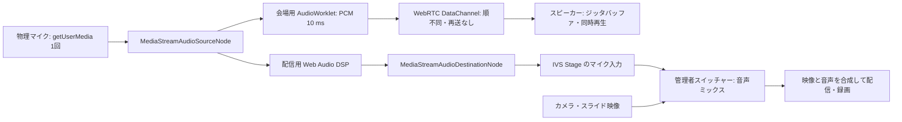

# 会場拡声と配信音声の分岐設計提案

作成日: 2026-10-27
状態: 初期実装済み。変更内容は[実装記録](./20261027-venue-audio-web-audio-implementation.md)を参照。iPhone 実機での成立と音響遅延は未検証。

## 結論

マイクを物理的に1回だけ取得し、Web Audio の音声グラフで会場用と配信用に分ける。会場側はアプリの音声加工を通さず、既存 PoC と同じ AudioWorklet → 48 kHz・16 bit・モノラル PCM → WebRTC DataChannel → スピーカー端末の経路を使う。配信側だけアプリで音声加工し、Web Audio から取り出した音声トラックを既存の IVS Stage に送る。管理者のスイッチャーがその音声をカメラ・スライド映像と合成し、視聴者向けに配信する。

この構成は標準 API と現在の IVS SDK の入力形式に整合する。ただし「iPhone Safari で必要な設定のまま安定動作する」「会場で音響遅延 50 ms 以下になる」「配信音質が現行以上になる」は、API の存在からは判断できない。実機測定を完了するまで本番利用可能とは判定しない。

## 背景と設計を変える理由

- 現行実装は配信向けに `echoCancellation`・`noiseSuppression`・`autoGainControl` を有効にして取得し、会場用トラックを `clone()` して3設定を無効化・確認する。iPhone 13 Safari / Chrome、iPhone 17 Safari では、その確認に失敗して会場送信開始前に止まった。これは DataChannel 自体の失敗を意味しない。
- PoC の DataChannel PCM 方式では、マイク2台・スピーカー1台で音声が聞こえた。したがって会場通信方式は維持し、問題になった分岐と入力処理の方を変更する。
- `MediaStreamTrack.clone()` は同じ入力源からトラックを作る API だが、ブラウザがトラックごとに異なるマイク前処理を独立適用できることまでは、この環境で確認できていない。新設計では個別 `applyConstraints()` に依存しない。
- ユーザーの優先順位は会場の低遅延が第一。配信音質は、会場側の遅延を増やさない範囲で維持・改善する。配信側は映像との同期を保てれば追加の処理時間を許容する。

## 目標と前提

| 項目 | 設計上の扱い |
| --- | --- |
| 物理マイク | 1端末で1回だけ取得。配信と会場で同じ音声を使う |
| 会場経路 | 入力 → 分岐 → 既存 AudioWorklet → DataChannel PCM → 既存受信・再生。アプリの配信用 DSP は通さない |
| 配信経路 | 入力 → 分岐 → 配信用 DSP → `MediaStreamAudioDestinationNode` → IVS Stage → 管理者スイッチャー → 映像と合成 |
| 会場の構成 | 最大3マイク・最大5スピーカー。各スピーカーで有効な全マイクを同時再生 |
| 配信の構成 | 既存仕様の最大5マイク。会場送信するマイクはそのうち最大3台 |
| 操作 | マイクごとの「会場スピーカーにも送信」スイッチを維持。配信開始・停止と独立。スピーカー音量は端末の物理ボタン |
| 遅延 | マイク入力からスピーカー出力まで目標50 ms以下、上限60 ms。RTTは代用指標にしない |
| 通信 | 既存の STUN のみ。直接接続が成立しなければ明示的なエラー。新たな音声中継サーバーは設けない |

**例:** MIC1 と MIC2 がそれぞれ配信中で、MIC2 だけ会場スイッチをオフにした場合、スイッチャーには両方の配信用音声が届き、会場スピーカーには MIC1 だけが届く。

## 分岐と音声処理の詳細

### 1. マイク取得

`getUserMedia()` は1回だけ呼ぶ。要求値は `echoCancellation:false`、`noiseSuppression:false`、`autoGainControl:false`、モノラル、48 kHz とする。ただし `getUserMedia` の制約要求と、実際に端末から出る完全な「生音声」は同義ではない。OS・ブラウザ・マイク機器側の固定処理が残る可能性があるため、`getSupportedConstraints()` と取得トラックの `getSettings()`、ブラウザ・OS・端末情報を診断ログへ記録する。未報告の設定値を勝手に `false` とみなさない。

設定が取得できない場合でも、現行の「3項目が明示的に false と確認できなければ送信不可」という条件では停止させない。代わりに状態を「処理状態未確認」と表示し、実機の音響遅延・音質測定で合否を決める。`getSettings()` が明示的に `true` を返した場合も記録・表示し、その条件で測った値を別扱いにする。ブラウザが実際にどの処理を行ったかの断定には使わない。

### 2. 会場経路

現在の `venue-live`、SDP 交換、STUN、`ordered:false`・`maxRetransmits:0` の DataChannel、PCM パケット形式、受信側ジッタバッファ・複数マイクのミックスは維持する。既存ワークレットは480サンプルを10 ms単位でパケット化し、受信側の目標待ち合わせは5〜15 ms。会場経路には配信用フィルタ、コンプレッサー、音量制御、意図的な遅延バッファを入れない。

分岐そのものは「音声サンプルを複製して別の出口へ渡す」操作で、追加のネットワーク往復や大きな蓄積を必要としない。ただし Web Audio の処理周期、端末の入出力バッファ、配信 DSP と共用する音声スレッドの負荷による遅延・音切れはありうる。会場側が配信 DSP の前を通る設計でも、実測なしに遅延ゼロとは言わない。

### 3. 配信経路

初期版の DSP は軽い音声調整に限定する。具体的には低域ノイズを抑えるハイパス、必要最小限の音量調整・コンプレッサーを候補とし、フィルタをすべてバイパスできるようにする。音質は現行配信音声との聴き比べと、音割れ・騒音・声量差の記録で評価し、値を固定する前に実機で調整する。`MediaStreamAudioDestinationNode.stream` から得た音声トラックを既存の `LocalStageStream` に渡す。IVS Stage を経由した後の管理者スイッチャーのマイク音量・ミュート・映像合成は現行のまま使う。

**重要:** 配信用にブラウザ標準の AEC（エコーキャンセル）・NS（ノイズ抑制）・AGC（自動音量調整）を無効にすると、ハイパスやコンプレッサーだけでは同等の処理にはならない。初期版で「現行音質を維持」とは保証しない。特に会場スピーカーの音をマイクが拾うと、エコーやハウリングの危険が増える。実測で問題が出た場合に配信側専用のノイズ抑制やエコー対策を追加検討するが、処理を重くする前にマイク・スピーカーの配置と音量を調整する。

### 4. 音声グラフの所有権と操作

マイク送信ページで1個の `AudioContext` と1個の入力 `MediaStreamAudioSourceNode` を管理する。同じ入力ノードから会場ワークレットと配信用 DSP の二方向へ接続する。配信用 `MediaStreamAudioDestinationNode` のトラックは再接続中も維持し、配信 DSP のオン・オフはグラフ内で切り替える。会場スイッチを切っても配信枝は切断・作り直ししない。

iOS では AudioContext の開始・再開を利用者の明示操作に結び付ける。初回の「マイクを確認」「送信開始」「会場スピーカーにも送信」のいずれからでも、`await getUserMedia()` より前のクリック処理で `resume()` を試み、その後に取得済み音声を接続する。コンテキストが停止した場合は画面に再開操作を出す。ページ終了時には会場セッション、IVS セッション、グラフ、物理マイクの順で終了する。片方の経路だけを止める操作ではもう片方のトラック・コンテキストを止めない。

「ミュート」は双方を無音にする。共通の入力トラックを `enabled=false` にし、IVS のミュート状態も同期する。会場スイッチは会場送信だけを切り替える。この違いを画面に明記し、現在の配信側だけに効くミュート動作を改める。

**例:** IVS が再接続中でも会場スイッチがオンなら会場送信を継続する。会場の STUN 接続が失敗しても、配信側の音声トラックは維持する。

## 変更するコードの範囲

| 対象 | 変更案 |
| --- | --- |
| `apps/web/src/features/sender/engine/media.ts` | マイク取得制約を会場優先に変更。会場用 `clone()` と個別 `applyConstraints()` に依存する処理を廃止 |
| `apps/web/src/features/sender/MicSendPage.tsx` | 共有グラフの初期化、双方の独立した開始・停止、共通ミュート、状態表示・異常時ログを管理 |
| 新しいマイク音声グラフのモジュール | 入力ノード、会場ワークレット接続、配信用 DSP、配信用トラック、バイパス・破棄を一箇所で管理 |
| `apps/web/src/features/venue/venueAudio.ts` | 既存の会場通信処理を再利用し、外部が所有する AudioContext・入力分岐を受けられるようにする。既存の PCM 通信・受信処理は維持 |
| `apps/web/src/features/sender/useStageSender.ts` と IVS ラッパー | 必要なら配信用トラック差し替え・再接続時の所有権を明確化。大幅な IVS 変更は予定しない |
| 管理者スイッチャー | 既存の音声ミキサー・映像合成を使う。初期実装では音ズレの計測・表示を優先し、補正が必要な場合だけ修正 |
| 診断・ログ | 会場と配信の両経路の開始・停止・失敗、設定、接続状態、パケット欠落、音声中断、試験条件を共通の試験 ID で追跡 |

既存 PoC ページは比較対象として残す。新しい経路は独立モジュールに置き、戻す場合は関連コミットを revert できる単位で変更する。stg での実機確認後に本番運用判定する。

## 異常時の動作と記録

| 事象 | 利用者への表示・動作 | 記録する情報 |
| --- | --- | --- |
| マイク権限拒否・入力途絶 | 双方停止、再許可または端末確認を案内 | エラー種別、ブラウザ、操作、トラック状態 |
| AudioContext 停止・AudioWorklet 読込失敗 | 会場・配信への影響を個別表示。再開ボタンを提示 | `AudioContext.state`、失敗段階、発生時刻 |
| 会場の STUN / DataChannel 失敗 | 会場スイッチを失敗状態にし、IVS は継続 | ICE / DataChannel 状態、接続数、PCM 送信統計 |
| IVS 接続・配信失敗 | 会場送信は継続、配信側に再接続状態を表示 | Stage 状態、失敗段階、再接続回数 |
| 配信用 DSP の異常 | 配信 DSP をバイパスし、音質調整なしの状態を表示。会場経路は維持 | DSP ノード種別、バイパス時刻、音声中断 |
| スピーカーで音が出ない | 消音モード解除、端末音量、再生開始操作、出力先を確認する案内 | 受信パケット、再生コンテキスト状態、アンダーフロー |

診断ログは現在のローカル保存と CSV / JSON エクスポートを拡張する。各端末の試験ログを同じ `trialId` で照合可能にし、マイク側とスピーカー側の両方を保存する。音声そのもの、認証情報、SDP に含まれる秘密情報は自動ログに入れない。音響遅延用の録音は試験者が明示的に開始した場合だけ保存する。

## 検証と合格条件

1. **自動試験:** 分岐先が正しいこと、会場スイッチで配信が止まらないこと、配信 DSP のバイパスで会場経路が変わらないこと、共通ミュートが双方に効くこと、片方の障害がもう片方を止めないこと、再接続時にマイク取得が増えないことを確認する。異常系を含め、実装時は変更ファイルに関係するミューテーションテストを回し、重要な誤配線・誤ミュート変異がテストで検出されることを確認する。PR・デプロイ時と最終確認では全体テスト・全体ミューテーションを行う。
2. **実機 1対1:** iPhone 13 Safari / Chrome、iPhone 17 Safari をマイクにした組み合わせを含め、iPad / MacBook をスピーカーにして、会場音・配信音・配信映像を同時に確認する。Safari と iOS Chrome は別々に記録する。音響遅延は同一録音に声の発生音とスピーカー音を入れて測り、RTT と混同しない。
3. **複数台:** 手元の iPhone 2台・iPad 1台・MacBook 1台で 1対多・多対多を実施し、各スピーカーで全マイクが同時に聞こえること、欠落・音切れ・ハウリング、端末操作時の復帰を確認する。今回の動作確認に厳密な1対5・3対5を必須とはしない。最大3対5を保証するときは、追加端末を確保して別途試験する。
4. **音質と同期:** 現行配信と新配信の音声を同条件で比較し、騒音・音割れ・声量差・エコーを記録する。映像内の拍手などで口形と配信音声のずれを測る。同期が崩れた場合は配信側だけで補正し、会場経路に待ち時間を足さない。
5. **連続運用:** 実際の会場 Wi-Fi、給電、画面点灯状態で長時間運転し、発熱、AudioContext の中断、再接続、欠落を記録する。スピーカーの消音モードは解除し、端末の音量ボタンで会場に合わせて調整する。

今回の検証での合格条件は、対象実機で会場音声が聞こえ、会場の音響遅延が目標50 ms以下・上限60 ms以内であり、配信音声と映像の同期・音質に許容できない問題がなく、1対1・1対多・多対多で安定して動くこと。最大3対5は設計・実装上の対応目標として残し、手元の4台での確認だけで最大構成の動作を保証しない。現行 PoC より悪化した場合は、ログと録音を基に原因を特定してから方式を再評価する。

## 仕様書との不一致と更新案

この提案は、[要件定義書](./spec/requirements.md) の **F-VEN-01** にある「会場用 `clone()`」と **F-VEN-07** にある「会場トラックだけ個別に音声処理を無効化し、設定を確認できなければ送信しない」「IVS 用はブラウザの既存音声処理を維持する」に一致しない。実装前に、次の内容へ更新する必要がある。

- **F-VEN-01:** 同じ物理マイクを1回だけ取得し、Web Audio で会場用と配信用に分岐する。
- **F-VEN-07:** 取得時にブラウザの AEC / NS / AGC 無効を要求し、会場側はアプリ DSP を通さない。配信側だけアプリ DSP を通す。設定値は診断情報として記録し、未報告を理由に自動停止しない。実機の音響遅延と音質で採用可否を判定する。
- **F-MIC-02 の補足:** 送信側ミュートは会場・配信双方に適用する。
- **会場運用文書:** [現行の会場音声運用](./20261026-venue-audio-operation.md) に残る clone 方式と、iPhone の消音モード解除・物理音量ボタンの操作説明を実装結果に合わせて更新する。

## 根拠と未解決の点

- Web Audio は入力音声をノードで分岐でき、`MediaStreamAudioDestinationNode` から音声トラックを取り出せる。[W3C Web Audio API](https://www.w3.org/TR/webaudio-1.0/)
- IVS の `LocalStageStream` は `MediaStreamTrack` を入力として受ける。[AWS IVS SDK API](https://aws.github.io/amazon-ivs-web-broadcast/docs/sdk-reference/classes/LocalStageStream)
- WebKit は iOS / iPadOS 14.5 以降に AudioWorklet を提供している。ただし機能の提供と、このアプリの実機性能は別の確認事項である。[WebKit 公式発表](https://webkit.org/blog/11648/new-webkit-features-in-safari-14-1/)
- WebRTC の公式サンプルには、Web Audio で処理したマイク音声を PeerConnection に送る例がある。これは「処理後の音声を通信に載せられる」実例であり、iPhone 上の会場遅延を保証するものではない。[WebRTC サンプル](https://webrtc.github.io/samples/src/content/peerconnection/webaudio-input/)

実装時に確認すべき最大の不確実性は、(1) iPhone の取得時処理が無効化されるか、(2) 単一 AudioContext での分岐と DSP 実行が会場遅延・音切れに与える影響、(3) 配信の AEC / NS / AGC をアプリ処理へ移した際の音質、(4) 管理者スイッチャーでの A/V 同期である。これらは設計時点では実測値がないため未確定とする。
